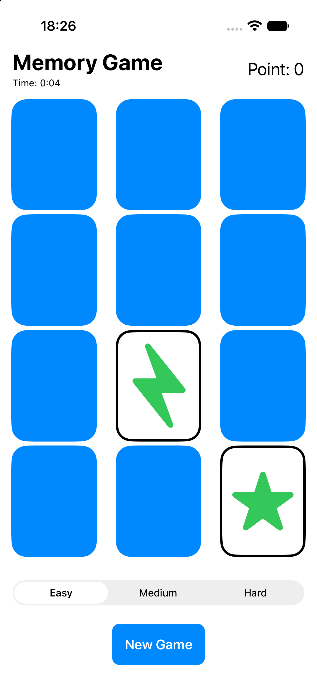
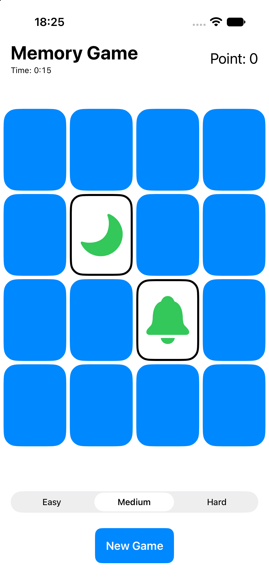
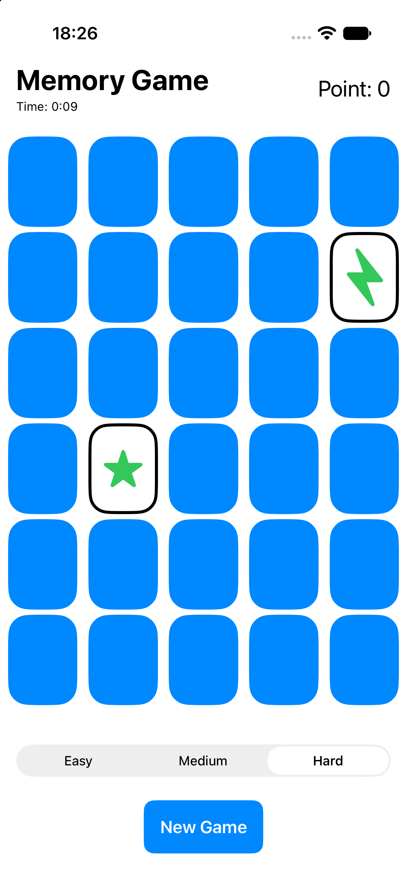

# Memory Game Demo

A small memory (concentration) card game for iOS, built with **SwiftUI** as a hands-on way to learn the iOS side of mobile development coming from a Kotlin/Jetpack Compose background.

Flip two cards at a time and match all the pairs. Matches score +2 points, a miss costs 1 point (never below 0), and a timer shows how long the round takes.

  
  
  

## Features

- Three difficulty levels (easy: 6 pairs, medium: 8, hard: 15), switchable on the fly
- Adaptive card grid that sizes cards to the available screen area
- 3D card-flip animation
- Score and elapsed-time display
- Localized UI strings via a String Catalog (`Localizable.xcstrings`)
- Unit tests with Swift Testing

## Architecture

MVVM with a plain-Swift model layer:

| Layer | Files | Responsibility |
|-------|-------|----------------|
| Model | `Card`, `MemoryGame`, `GameDifficulty` | Game rules and state. Pure value types, no UI dependencies. |
| ViewModel | `EmojiMemoryGame` | `@Observable` class that exposes the model to the UI and owns the timer. |
| View | `ContentView`, `CardView` | Declarative SwiftUI views driven by the view model's state. |

The game logic lives in a `struct` with `mutating` functions, so the model stays easy to test and the view model only forwards user intents (`choose`, `startNewGame`).

## Requirements

- Xcode 26 or newer
- iOS 26.2 deployment target (as configured in the project)

## Run it

1. Open `Memory Game Demo App.xcodeproj` in Xcode.
2. Select an iPhone simulator or device.
3. Press **Run** (⌘R). Tests run with **Test** (⌘U).

## Possible next steps

- Persist best scores and times
- Use image or music-themed card sets instead of SF Symbols
- Prevent taps during the mismatch animation and add a short delay before flipping cards back
- Add UI tests and accessibility labels
